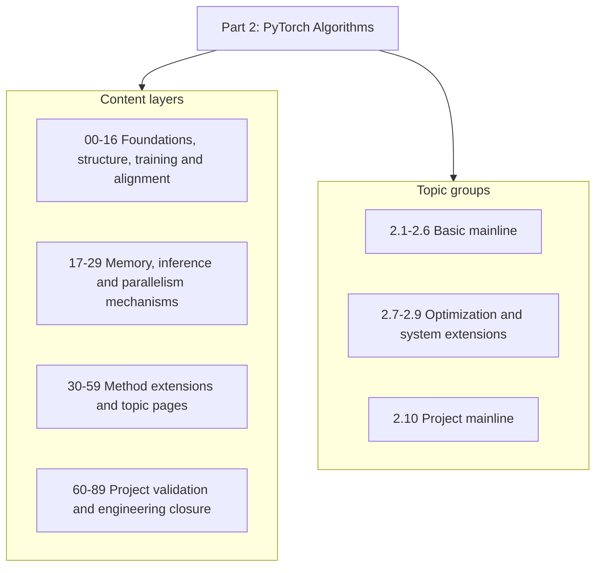

# Part 02: PyTorch Algorithm Practice

## Part Overview

This part focuses on LLM implementation at the PyTorch level. Positioned after Part 0 / Part 1 and before Part 3, it is responsible for connecting operators, model structure, training, alignment, memory, inference, parallelism, and project validation into one engineering implementation chain. The body text is notebook-first by default; group pages handle the reading order within a group, and the Part-level guide only explains the overall structure and entry points.

Part 02 is organized into 10 topic groups: `2.1-2.6` establish basic operators, models, training, memory, and inference intuition, `2.7-2.9` extend to inference strategies, quantization, communication, and parallelism, and `2.10` handles project validation and engineering closure. Concrete chapter status and per-section assets are handled by the group pages and maintenance documents.




## Division of Labor Between Part 02, Part 03, and Part 04

This is the core framework for understanding whether the 89 files are reasonable.

| Part | Name | Core question | Abstraction level | Audience |
|:---|:---|:---|:---|:---|
| Part 00 | Prerequisites | "How do I use Python/PyTorch?" | Language/framework fundamentals | Everyone |
| Part 01 | Hardware, Math & Systems | "What happens on the hardware?" | Hardware/system principles | Systems engineers |
| Part 02 | PyTorch Algorithms | "How do I express an algorithm in code?" | Algorithm implementation | Algorithm/engineering developers |
| Part 03 | Triton Kernels | "How do I write this operator faster?" | High-performance operators | Systems/performance engineers |
| Part 04 | CUDA & System Optimization | "How do I optimize the system to the extreme?" | Extreme system optimization | Systems engineers |

### Key Boundaries

```text
Part 02 (algorithm implementation): answers "How do I write this algorithm in PyTorch?"
    ↓ when PyTorch is not fast enough
Part 03 (Triton operators): answers "How do I write this operator faster in Triton?"
    ↓ when Triton is not low-level enough / extreme optimization is needed
Part 04 (CUDA / systems): answers "How do I perform extreme optimization at the CUDA level for this system?"
```

## Part Asset Overview

The content of this chapter is organized into 10 topic groups, and later pages continue to expand along this structure.

> Navigation note: start with the overview, then enter the specific group pages.
> Group pages handle the reading order within a group and the asset closure; you do not need to read all pages at once.
> Part 2 is both a hands-on engineering catalog and the common connective layer after Part 0 / Part 1 and before Part 3.

| Learning group | Responsibility | Entry and representative content | Size |
|:---|:---|:---|:---|
| [2.1](./2_1.md) | Establish intuition for basic operators and components | 00-04: basic operators, Attention | 5 |
| [2.2](./2_2.md) | Assemble model structure and understand MoE components | 05-08: Block, MoE, structural techniques | 4 |
| [2.3](./2_3.md) | Establish a closed loop of SFT, LoRA, and training updates | 09-13: training and fine-tuning | 5 |
| [2.4](./2_4.md) | Understand preference optimization and the alignment chain | 14-16: PPO, DPO, GRPO | 3 |
| [2.5](./2_5.md) | Understand backpropagation and training-side memory optimization | 17-19: Autograd, activation, and checkpoint | 3 |
| [2.6](./2_6.md) | Build intuition for inference acceleration and caching | 20-22: Attention, decoding, PagedAttention | 3 |
| [2.7](./2_7.md) | Go deeper into serving, cache, and scheduling | 23-24 + 34-39: advanced inference | 8 |
| [2.8](./2_8.md) | Understand model compression and quantization | 25-26 + 40-45: quantization and compression | 8 |
| [2.9](./2_9.md) | Build judgment on communication and parallelism strategies | 27-29 + 46-49: parallelism and communication | 7 |
| [2.10](./2_10.md) | Validate the preceding mechanisms and methods with projects | 60-89: training, inference, memory, parallelism, and alignment projects | 30 |

## Learning Path

Part 2 can be understood through multiple entries: the zero-foundation entry first links operators, assembly, training, and the project loop; the training-first, inference-first, and parallelism-first entries start from different engineering goals and all return to project practice in the end.

### Recommended Order

- Zero-foundation entry: start with [2.1](./2_1.md) -> [2.2](./2_2.md) -> [2.3](./2_3.md) -> [2.5](./2_5.md) -> [2.10](./2_10.md)
- Training-first entry: start with [2.3](./2_3.md) -> [2.4](./2_4.md) -> [2.5](./2_5.md) -> [2.10](./2_10.md)
- Alignment-first entry: start with [2.3](./2_3.md) -> [2.4](./2_4.md) -> [2.10](./2_10.md)
- Inference-first entry: start with [2.6](./2_6.md) -> [2.7](./2_7.md) -> [2.8](./2_8.md); if continuing along the systems and distributed chain, then enter [2.9](./2_9.md) -> [2.10](./2_10.md)
- Parallelism-first entry: start with [2.9](./2_9.md) -> [2.10](./2_10.md)
- Systematic study: proceed in the order [2.1](./2_1.md) -> [2.2](./2_2.md) -> [2.3](./2_3.md) -> [2.4](./2_4.md) -> [2.5](./2_5.md) -> [2.6](./2_6.md) -> [2.7](./2_7.md) -> [2.8](./2_8.md) -> [2.9](./2_9.md) -> [2.10](./2_10.md)

### Next Steps

- Foundational understanding layer: first read [2.1](./2_1.md) and [2.2](./2_2.md) to establish basic operators and model assembly, then enter [2.5](./2_5.md) as needed.
- Training and alignment layer: first read [2.3](./2_3.md), [2.4](./2_4.md), and [2.5](./2_5.md) to straighten out the chain of training, alignment, and memory optimization; this mainly connects to later implementation pages and project pages.
- Inference and parallelism layer: first read [2.6](./2_6.md), [2.7](./2_7.md), [2.8](./2_8.md), and [2.9](./2_9.md) to connect inference, compression, and parallelism strategies; this mainly connects to project practice and later implementation pages.
- Project closure: finally read [2.10](./2_10.md) to put the preceding knowledge points back into real projects for validation and wrap-up.

## Environment Notes

- The overall learning path is organized CPU-first by default, prioritizing conceptual understanding, logic validation, and minimal correctness.
- Only Part-level unified prerequisites are written here, without pointing to specific section numbers.
- A small number of advanced notebooks treat a GPU, multiple GPUs, or a complete toolchain as extended validation conditions; if such requirements exist, the single-page notes prevail and they are not expanded again on the guide page.

The runtime environment of Part 02 is divided into three layers:

| Environment layer | Applicable content | What learners need to prepare |
|:---|:---|:---|
| CPU-first | Concepts, answer tests, and most Notebooks | Python and PyTorch CPU dependencies |
| GPU PyTorch | Real training, memory, and CUDA measurements | NVIDIA GPU, matching driver, CUDA build of PyTorch, Transformers |
| GPU serving | Real inference backends and throughput tests | GPU PyTorch environment, plus a vLLM matching the current CUDA / driver |

In Colab or ModelScope Notebook, all dependencies are installed into the current runtime by default, and learners are not required to create multiple Conda environments. Only when a local machine maintains multiple CUDA / vLLM versions at the same time do you choose an independent vLLM environment through the environment name in the single-section configuration. Specific dependency installation commands and version constraints are described separately by the Notebook that needs that environment.

Therefore, the default path for learners is “one runtime / one virtual environment”. Multiple local environments are only an optional fallback when vLLM and PyTorch dependencies conflict; they are not two sets of environments that must be set up before starting to learn.

### Unified Conventions for Real-Model and GPU Experiments

Projects in Part 02 that need a real model or a real GPU use a “download once, reuse the cache, enable per section” workflow:

- Models use `MODEL_SOURCE = "auto"` by default, reusing the local model directory first; only when it is not available locally is the model downloaded from Hugging Face or ModelScope.
- Models are cached uniformly in `model_cache/` under the project root, so the same model is downloaded only once, and training, inference, and memory experiments share the same weights.
- When a local model already exists, you can set `MODEL_SOURCE = "local"` and change `MODEL_ID` to the model directory; when the network is restricted, you can explicitly use `MODEL_SOURCE = "modelscope"`.
- Real experiments are off by default and do not affect the CPU-first answer tests; only after learners confirm that the GPU, driver, PyTorch, and the corresponding runtime are available do they turn on the real-experiment switch in a single section.
- Local, Colab, and ModelScope Notebook should all use the repository or a persistent directory as the working directory; experiment results are saved uniformly to `benchmarks/results/` to avoid being lost after a session restart.
- The Part-level Intro only defines this workflow; model size, data type, sequence length, port, and memory threshold are the responsibility of the environment notes of the specific notebook.

The minimal preparation procedure is as follows:

```python
MODEL_SOURCE = "auto"       # auto / huggingface / modelscope / local
MODEL_CACHE_DIR = "model_cache"
```

The first run downloads the model, and later projects reuse the cache directly. In Colab or ModelScope, if a temporary disk is used, point `MODEL_CACHE_DIR` and `benchmarks/results/` to a persistent directory.
