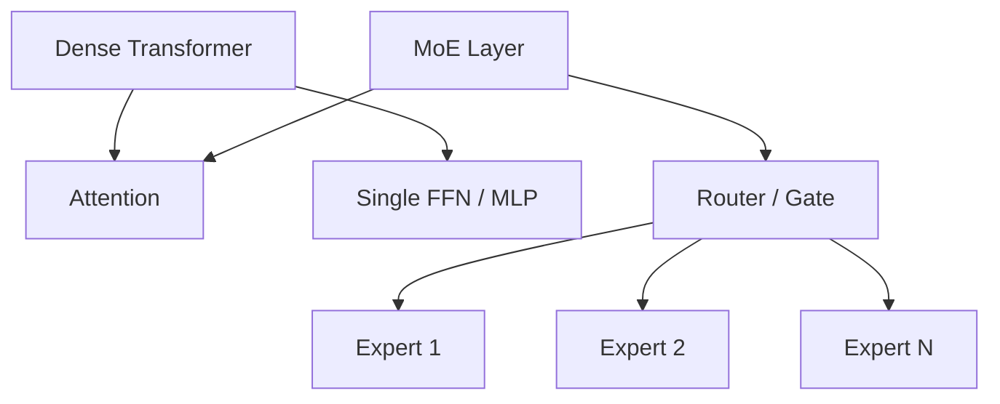
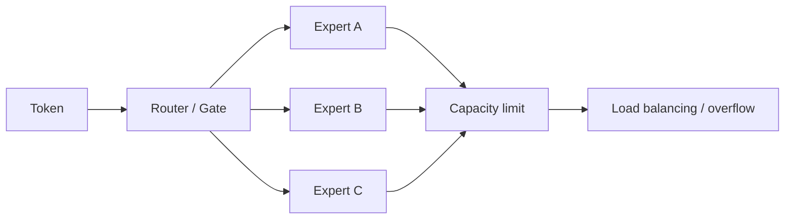

# 22. MoE Parameter and Compute | MoE 模型参数量计算

**Difficulty:** Medium-Hard | **Environment:** CPU-first | **Tags:** `model structure`, `MoE`, `parameters and compute` | **Audience:** learners studying hardware constraints

> 🚀 **云端运行环境**
>
> 本章节的实战代码可以点击以下链接在免费 GPU 算力平台上直接运行：
>
> [](https://colab.research.google.com/github/datawhalechina/llm-algo-leetcode/blob/main/01_Hardware_Math_and_Systems/22_MoE_Parameter_and_Compute.ipynb)
> [](https://modelscope.cn/my/mynotebook) *(国内推荐：魔搭社区免费实例)*


---

## Section Guide

Mixture-of-Experts (MoE) models expand the total parameter count by adding experts, but each token activates only part of them. The total parameter count, active compute volume, and expert load therefore no longer grow in sync.
This section establishes the relationship "routing choice → expert activation → capacity and load → communication cost". After completing it, you should be able to explain why sparse activation can control the compute volume, and how imbalanced load weakens this benefit.

**Keywords:** experts, router, load balancing


---
## Prerequisite Reading

**Overview:** First review parameter counts, memory, and distributed communication, then observe why MoE can expand the total capacity while introducing routing, load balancing, and expert-parallel communication problems.

- [01. Data Types and Precision](./01_Data_Types_and_Precision.md)
- [02. LLM Params and FLOPs](./02_LLM_Params_and_FLOPs.md)
- [05. Communication Topologies](./05_Communication_Topologies.md)
---
## Q1: Where does the parameter count of MoE differ from a plain dense Transformer?


In a plain dense Transformer, the parameters of each layer mainly come from:
- Attention
- FFN / MLP

MoE replaces the original FFN / MLP with multiple experts. Roughly speaking:

- The parameter count of one dense FFN is about `2 d d_ff`
- If there are `E` experts, the total expert parameter count is about `E × 2 d d_ff`
- But each token usually activates only `k` experts rather than all `E`

So the characteristics of MoE are:
- **Total parameter count**: very large
- **Parameters activated per token**: relatively not that large
- **Compute per token**: usually grows with `k` rather than `E`

This is why MoE is often used to expand model capacity without linearly scaling every computation. The "active parameter count" here only describes the expert scale that a token passes through; complete inference FLOPs also include Attention, Router, data movement, and other operators, so the active parameter count cannot be treated directly as the complete FLOPs.

A most common intuitive example is Mixtral 8x7B:

| Dimension | Order-of-magnitude intuition |
| --- | --- |
| Hidden dimension `d` | 4096 |
| Number of experts `E` | 8 |
| Activated experts `k` | 2 |
| `d_ff` | about `4d = 16384` |

If only the expert FFN is considered, the parameter count of a single expert is about `2 × d × d_ff ≈ 134M`, and the 8 experts add up to about the `1.07B` level. After adding Attention, Embedding, and other layers, the total model parameters can reach about `47B`, but each token actually activates only a small part of them; the common statement is that the "active parameters" are at about the `13B` level.



### Q1 Mini Check: Compute expert parameter counts and active FFN FLOPs

Write the parameter-count formulas, then compare the total parameters, active parameters, and expert FFN FLOPs of dense and MoE.

```python
import math
import torch
from typing import Dict, List


def dense_ffn_params(d: int, d_ff: int) -> int:
    """Parameter count of a dense FFN/MLP, estimated as 2 * d * d_ff."""
    return 2 * d * d_ff


def moe_expert_params(d: int, d_ff: int, num_experts: int) -> int:
    """Total parameter count of all MoE experts."""
    return num_experts * dense_ffn_params(d, d_ff)


def active_expert_params(d: int, d_ff: int, active_experts: int) -> int:
    """Parameter count of the experts activated by a single token."""
    return active_experts * dense_ffn_params(d, d_ff)


def active_expert_ffn_flops(d: int, d_ff: int, active_experts: int, flops_per_param: int = 2) -> int:
    """Estimate the FFN matrix-multiplication FLOPs of the experts activated by a single token.

    Only the multiply-add of the expert FFN is estimated here, excluding Attention, Router, routing transfer, and communication.
    """
    if active_experts <= 0 or flops_per_param <= 0:
        raise ValueError('active_experts 和 flops_per_param 必须为正数')
    return active_expert_params(d, d_ff, active_experts) * flops_per_param


def moe_layer_params(d: int, d_ff: int, num_experts: int, include_router: bool = True) -> int:
    """Rough parameter count of one MoE layer: Attention + Experts + Router."""
    attention_params = 4 * d * d
    router_params = d * num_experts if include_router else 0
    return attention_params + moe_expert_params(d, d_ff, num_experts) + router_params


def to_million(x: int) -> float:
    return x / 1e6


def to_billion(x: int) -> float:
    return x / 1e9

```


```python
def test_moe_parameter_formulas():
    d = 4096
    d_ff = 16384
    experts = 8
    active = 2

    dense = dense_ffn_params(d, d_ff)
    total_expert = moe_expert_params(d, d_ff, experts)
    active_params = active_expert_params(d, d_ff, active)
    active_flops = active_expert_ffn_flops(d, d_ff, active)
    layer_params = moe_layer_params(d, d_ff, experts)

    assert dense == 134_217_728, dense
    assert total_expert == 1_073_741_824, total_expert
    assert active_params == 268_435_456, active_params
    assert active_flops == 536_870_912, active_flops
    assert layer_params == 1_140_883_456, layer_params
    print('✅ MoE 参数量公式测试通过')


test_moe_parameter_formulas()

print('单个 dense FFN 参数量:', to_million(dense_ffn_params(4096, 16384)), 'M')
print('8 个专家的总参数量:', to_billion(moe_expert_params(4096, 16384, 8)), 'B')
print('top-2 激活参数量:', to_billion(active_expert_params(4096, 16384, 2)), 'B')
print('top-2 专家 FFN FLOPs / token:', active_expert_ffn_flops(4096, 16384, 2))
print('MoE 单层粗略参数量:', to_billion(moe_layer_params(4096, 16384, 8)), 'B')

```

## Q2: Why is the Router / Gate important?


The Router / Gate first selects the top-k experts according to the score of each token, then determines whether each expert will be overloaded and whether the routing result will introduce extra communication and synchronization overhead.

In principle, the Router handles at least three things at the same time:

1. **Select experts**
   - Score each token and decide which top-k experts it goes to.
   - This step determines the token's compute path; different tokens may go through completely different experts.

2. **Control capacity**
   - The number of tokens each expert can receive is limited.
   - If the token distribution is uneven, some experts are overloaded, and some tokens may be dropped or forced to be reassigned.

3. **Affect training stability**
   - If routing favors a few experts for a long time, MoE may degenerate into "a few experts working while the rest are idle".
   - Therefore many schemes introduce a load balancing loss or a capacity factor to force more even routing.

This is also why MoE is not just "more parameters": its engineering difficulty actually lies in routing quality and load balancing rather than in the FFN parameters themselves. The current mini-check only observes top-k routing, capacity, and overflow; the load balancing loss is retained here as a conceptual description of a training mechanism and is not computed directly by this code.



### Q2 Mini Check: Observe the capacity and load balancing of the Router / Gate

First estimate the capacity of each expert, then see what happens when the token distribution is uneven.

```python
def expert_capacity(num_tokens: int, num_experts: int, capacity_factor: float = 1.0) -> int:
    """Upper limit of the number of tokens each expert can receive."""
    return math.ceil(num_tokens / num_experts * capacity_factor)


def overflow_tokens(token_counts: List[int], capacity: int) -> int:
    """Given the number of tokens each expert receives, compute the total number of overflow tokens."""
    return sum(max(0, c - capacity) for c in token_counts)


def load_balance_stats(token_counts: List[int], capacity: int) -> Dict[str, float]:
    """Compute capacity and overflow from the expert token counts already produced by the Router."""
    total = sum(token_counts)
    overflow = overflow_tokens(token_counts, capacity)
    return {
        'total_tokens': total,
        'capacity_per_expert': capacity,
        'max_tokens': max(token_counts),
        'min_tokens': min(token_counts),
        'overflow_tokens': overflow,
        'drop_rate': overflow / total if total else 0.0,
    }


def route_tokens(router_scores: torch.Tensor, top_k: int = 1) -> Dict[str, object]:
    """Select the top-k experts from the token scores for each expert and summarize the distribution.

    The input shape is `[num_tokens, num_experts]`; this only simulates discrete routing,
    and does not implement expert networks, capacity truncation, or cross-device communication.
    """
    if router_scores.ndim != 2:
        raise ValueError('router_scores 必须是 [num_tokens, num_experts]')
    num_tokens, num_experts = router_scores.shape
    if not 1 <= top_k <= num_experts:
        raise ValueError('top_k 必须在 1 和 num_experts 之间')
    selected = torch.topk(router_scores, k=top_k, dim=-1).indices
    token_counts = torch.bincount(selected.reshape(-1), minlength=num_experts).tolist()
    return {'selected_experts': selected, 'token_counts': token_counts, 'top_k': top_k}


torch.manual_seed(0)
router_scores = torch.randn(32, 4)
route = route_tokens(router_scores, top_k=2)
print('top-k 路由后的专家 token 数:', route['token_counts'])
assert route['selected_experts'].shape == (32, 2)
assert sum(route['token_counts']) == 32 * 2

```


```python
token_counts = [140, 40, 70, 90, 110, 80, 60, 110]
capacity = expert_capacity(sum(token_counts), len(token_counts), capacity_factor=1.0)
stats = load_balance_stats(token_counts, capacity)

print('专家 token 分布:', token_counts)
print('每个专家容量上限:', capacity)
print('-' * 60)
for k, v in stats.items():
    if k.endswith('rate'):
        print(f'{k:20s}: {v:.1%}')
    else:
        print(f'{k:20s}: {v}')

```

## Q3: Why is the engineering cost of MoE not only in compute but also in communication?


The extra cost of MoE mainly comes from token scheduling and All-to-All communication under expert parallelism (Expert Parallelism).

This layer can be understood as:
- Tokens are first dispatched to the devices hosting different experts according to the Router result
- After the experts finish computing, the results are gathered back to the original sequence positions

This means MoE communication is not "moving a bit of data along the way"; a fairly explicit dispatch / gather process appears in every layer.

If the token count, hidden_dim, or batch grows, the communication volume increases noticeably; if the token distribution is uneven, some expert devices are also busier than others, further amplifying the tail waiting time.

So the core trade-off of MoE can be summarized as:
- **Capacity**: larger
- **Active compute**: not necessarily larger by the same ratio
- **System complexity**: higher, especially routing, load balancing, and communication


### Q3 Mini Check: Roughly estimate the expert-parallel communication volume

First treat top-k as the number of routing copies per token, estimate the dispatch / gather data volume per layer, and then see why it becomes an engineering cost of MoE. This result is a capacity-level estimate, not a measured NCCL All-to-All.


```python
def estimate_expert_parallel_traffic(
    batch: int,
    seq_len: int,
    hidden_dim: int,
    num_experts: int,
    num_devices: int,
    top_k: int = 1,
    bytes_per_param: int = 2,
    dispatch_and_gather_factor: float = 2.0,
) -> int:
    """Roughly estimate the expert-parallel communication volume (bytes).

    The order of magnitude is estimated from the token count, hidden size, top-k, and the number of
    dispatch/gather passes; it does not represent a real NCCL All-to-All trace.
    """
    tokens = batch * seq_len
    traffic = tokens * hidden_dim * bytes_per_param
    if top_k <= 0 or num_devices <= 0:
        raise ValueError('top_k 和 num_devices 必须为正数')
    traffic *= top_k
    traffic *= (num_experts / num_devices)
    traffic *= dispatch_and_gather_factor
    return int(traffic)


def bytes_to_mb(x: int) -> float:
    return x / 1e6


def bytes_to_gb(x: int) -> float:
    return x / 1e9

```


```python
batch = 8
seq_len = 2048
hidden_dim = 4096
num_experts = 8
num_devices = 8
top_k = 2
traffic = estimate_expert_parallel_traffic(
    batch, seq_len, hidden_dim, num_experts, num_devices, top_k=top_k
)

print('专家并行通信量粗估：')
print('-' * 60)
print(f'batch={batch}, seq_len={seq_len}, hidden_dim={hidden_dim}, top_k={top_k}')
print(f'communication = {bytes_to_mb(traffic):.1f} MB / layer')
print(f'communication = {bytes_to_gb(traffic):.3f} GB / layer')

```


```python
def test_traffic_estimation():
    traffic_small = estimate_expert_parallel_traffic(4, 1024, 4096, 8, 8, top_k=1)
    traffic_large = estimate_expert_parallel_traffic(8, 2048, 4096, 8, 8, top_k=1)
    traffic_top2 = estimate_expert_parallel_traffic(4, 1024, 4096, 8, 8, top_k=2)
    assert traffic_small > 0
    assert traffic_large > traffic_small
    assert traffic_large == 4 * traffic_small
    assert traffic_top2 == 2 * traffic_small
    print('✅ 通信量测试通过')


test_traffic_estimation()

```

## Q4: What adoption evidence is still missing from the MoE ledger?


The parameter and compute ledger can identify MoE capacity candidates, but it cannot directly decide to adopt MoE. Forming a candidate usually requires two preconditions:

- You want to expand model capacity but do not want to scale the compute volume along with every inference
- You can accept a more complex routing, scheduling, and communication implementation

The following situations indicate that the evidence is still incomplete:
- You care more about implementation simplicity, stability, and predictability
- Your system bandwidth / communication conditions are not ideal
- You find it hard to accept the training fluctuation caused by imbalanced routing

You can first use the condition table below to record ledger signals and missing evidence, then enter the architecture, communication, and performance topics for verification:

| Ledger or system signal | Still to verify |
| --- | --- |
| High total parameter demand, active parameters clearly below the total | Quality, actual throughput, and memory residency |
| Experts need to be placed across devices | All-to-All communication volume, exposed time, and scaling efficiency |
| Imbalanced expert load or capacity overflow | Router distribution, overflow, and tail waiting |
| Serving requires simple implementation and predictable latency | Scheduling complexity, tail latency, and fallback options |

This table only converts the theoretical ledger into a checklist to be measured; the final choice still needs recorded quality, throughput, communication time, and tail latency.

### Q4 Mini Check: Generate a measurement checklist from the ledger

Convert the capacity requirement, communication conditions, load balancing, and engineering simplicity into evidence that needs to be collected afterward.


```python
def moe_follow_up_evidence(capacity_need, communication_ready, load_balance_ok, simplicity_priority):
    """Convert MoE ledger signals into follow-up evidence to measure, without giving an adoption decision directly."""
    flags = [capacity_need, communication_ready, load_balance_ok, simplicity_priority]
    if not all(isinstance(value, bool) for value in flags):
        raise TypeError('四个条件必须是 bool')
    required = ['quality', 'throughput', 'tail_latency']
    if capacity_need:
        required.append('capacity_gain')
    if not communication_ready:
        required.extend(['all_to_all_time', 'scaling_efficiency'])
    if not load_balance_ok:
        required.extend(['expert_load_distribution', 'overflow_rate'])
    if simplicity_priority:
        required.extend(['scheduling_complexity', 'fallback_path'])
    return {
        'ledger_signal': 'capacity_candidate' if capacity_need else 'no_capacity_pressure',
        'required_measurements': sorted(set(required)),
        'evidence_level': 'theoretical_ledger',
    }

cases = [
    (True, True, True, False),
    (True, False, True, False),
    (False, True, True, True),
]
for case in cases:
    print(case, '->', moe_follow_up_evidence(*case))
assert 'capacity_gain' in moe_follow_up_evidence(True, True, True, False)['required_measurements']
assert 'all_to_all_time' in moe_follow_up_evidence(True, False, True, False)['required_measurements']
assert 'fallback_path' in moe_follow_up_evidence(False, True, True, True)['required_measurements']
print('✅ MoE 待测证据清单检查通过')

```

---
## Related Reading

**Overview:** Connect the parameter and compute ledger to the Router and expert parallelism, and continue observing capacity, overflow, and cross-GPU token exchange.

- [Part 02 · 06 MoE Router](../02_PyTorch_Algorithms/06_MoE_Router.md)
- [Part 02 · 07 MoE Load Balancing](../02_PyTorch_Algorithms/07_MoE_Load_Balancing_Loss.md)
- [Part 02 · 46 MoE Expert Parallel](../02_PyTorch_Algorithms/46_MoE_Expert_Parallel.md)
---