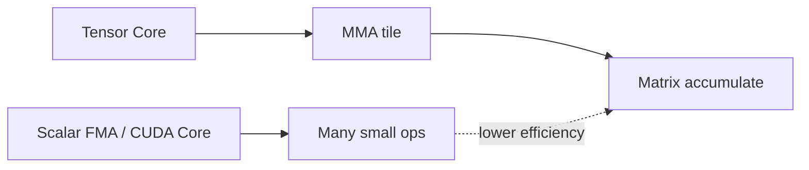
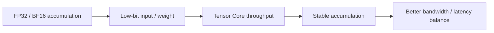
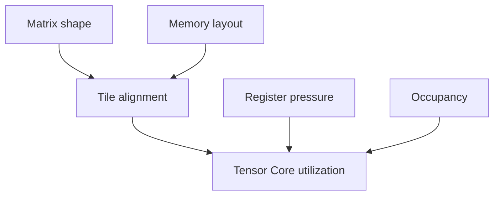

# 23. TensorCore Deep Dive | Tensor Core 深度剖析

**Difficulty:** Hard | **Environment:** CPU-first | **Tags:** `hardware systems`, `Tensor Core`, `MMA` | **Audience:** learners who need to understand the hardware path of matrix computation

> 🚀 **云端运行环境**
>
> 本章节的实战代码可以点击以下链接在免费 GPU 算力平台上直接运行：
>
> [](https://colab.research.google.com/github/datawhalechina/llm-algo-leetcode/blob/main/01_Hardware_Math_and_Systems/23_TensorCore_Deep_Dive.ipynb)
> [](https://modelscope.cn/my/mynotebook) *(国内推荐：魔搭社区免费实例)*


---

## Section Guide

A Tensor Core can execute the matrix multiply-add (MMA) path only when the data type, matrix shape, memory layout, and register resources meet the conditions. Theoretical peak cannot replace checking the actual input and resource constraints.
This section establishes the relationship "matrix tiling → data layout → MMA execution → resource limits". After completing it, you should be able to judge whether an input meets the Tensor Core candidate conditions and distinguish theoretical paths from real throughput.

**Keywords:** `MMA`, matrix tiling, throughput


---
## Prerequisite Reading

**Overview:** First review matrix multiply-add, mixed precision, and CUDA execution granularity, then understand why the Tensor Core requires input data to be organized into specific tiles.

- [15. CUDA Execution Model](./15_CUDA_Execution_Model.md)
- [16. Warp Block SharedMemory Basics](./16_Warp_Block_SharedMemory_Basics.md)
- [12. TensorCore and Mixed Precision](./12_TensorCore_and_Mixed_Precision.md)
---
## Q1: What is the Tensor Core essentially?


The Tensor Core is not a faster version of an ordinary CUDA Core, but a hardware path specifically oriented to matrix multiply-add (MMA).

Its key changes are three:
- The computation object changes from scalar FMA to small-block matrix multiply-add;
- The scheduling granularity changes from per-element operations to packable tiles;
- The data path changes from "many scalar memory accesses" to "gather into a block first, then perform matrix accumulation at once".



So the Tensor Core is more like a dedicated engine for matrix computation: it does not make the same work a little faster, but reorganizes the work into a shape better suited to hardware throughput.

### Q1 Mini Check: Compare matrix multiply-add with scalar FMA

Compare the two computation granularities to explain why tiled matrix multiply-add is better suited to the Tensor Core.

```python
def mma_flops(m, n, k):
    return 2 * m * n * k

print(mma_flops(16, 16, 16) / 1e3, 'KFLOPs for one 16x16x16 MMA')
```

## Q2: Which dtypes and accumulation modes meet the candidate conditions for entering the Tensor Core?


Mixed precision is effective because the three segments "input / accumulation / output" do not need to use the same bit width.

A common practice is:
- Use lower precision for inputs and weights to reduce transfer and packing cost;
- Keep higher precision for accumulation to avoid rapidly amplifying the error;
- Return some intermediate results to lower precision or keep them at high precision as needed.

Whether the Tensor Core candidate path can be entered also depends on the support of the GPU architecture, driver, and specific kernel. The `supported_dtypes` in the code is a configuration input of the hardware to be tested and should not be understood as all GPUs natively supporting these formats; being able to allocate a certain dtype does not mean it will necessarily get Tensor Core acceleration.



So mixed precision is not simply "lowering precision", but splitting responsibilities between precision and throughput: putting the most expensive transfer and the parts that most need throughput onto more suitable bit widths and hardware paths.

### Q2 Mini Check: Check the dtype, accumulation type, and candidate path

Compare the input and accumulation types to distinguish the theoretical storage volume from the conditions for entering the candidate path.

```python
def tensorcore_dtype_path(input_dtype, accumulation_dtype, numel, supported_dtypes=('FP16', 'BF16', 'FP8')):
    """Check whether the dtype and accumulation type meet the conditions for entering the candidate path.

    supported_dtypes should be configured according to the GPU and kernel capabilities to be tested; this shows
    both the theoretical storage and the path conditions, and does not mean the current GPU has executed Tensor Core.
    """
    dtype_bytes = {'FP32': 4, 'FP16': 2, 'BF16': 2, 'FP8': 1}
    if numel <= 0:
        raise ValueError('numel 必须为正数')
    if input_dtype not in dtype_bytes:
        raise ValueError(f'未知 input_dtype: {input_dtype}')
    input_supported = input_dtype in supported_dtypes
    accumulation_supported = accumulation_dtype in {'FP32', 'BF16'}
    return {
        'input_dtype': input_dtype,
        'accumulation_dtype': accumulation_dtype,
        'storage_mb': round(numel * dtype_bytes[input_dtype] / 1024 / 1024, 2),
        'path_candidate': input_supported and accumulation_supported,
        'reasons': ([ ] if input_supported else ['input_dtype_not_supported']) + ([ ] if accumulation_supported else ['accumulation_dtype_not_supported']),
    }

numel = 4096 * 4096
for input_dtype in ['FP32', 'FP16', 'BF16', 'FP8']:
    print(input_dtype, '->', tensorcore_dtype_path(input_dtype, 'FP32', numel))
assert tensorcore_dtype_path('BF16', 'FP32', numel)['path_candidate']
assert not tensorcore_dtype_path('FP32', 'FP32', numel)['path_candidate']
try:
    tensorcore_dtype_path('BF16', 'FP32', 0)
except ValueError:
    print('✅ dtype 路径输入校验通过')
else:
    raise AssertionError('numel 为 0 时应报错')
```

## Q3: Why can Tensor Core utilization still not be saturated after the candidate conditions are met?


Tensor Core utilization is constrained at three levels:
- **Whether the tile is aligned**: when the shape is unsuitable, the hardware struggles to pack the work completely;
- **Whether the layout is contiguous**: a non-contiguous layout fragments the memory accesses before and after packing;
- **Whether registers / occupancy allow it**: with too many temporary variables, the compute units may not be continuously fed to capacity.



Therefore, Tensor Core utilization is not "used means achieved"; it depends on whether the input size, layout, synchronization method, and temporary variables all allow it to enter the high-throughput path.

### Q3 Mini Check: Why alignment and packing matter

A suitable shape enters the high-throughput path more easily.

```python
def tensorcore_utilization_factors(m, n, k, tile=16, layout_contiguous=True, occupancy=1.0, register_pressure=32, register_budget=64):
    """Organize the candidate conditions of shape, layout, occupancy, and register pressure.

    occupancy and register_budget are teaching inputs, not universal thresholds of a certain GPU;
    actual utilization still needs to be verified by a profiler or a fixed-workload benchmark.
    """
    if min(m, n, k, tile, register_pressure, register_budget) <= 0:
        raise ValueError('矩阵维度、tile 和寄存器参数必须为正数')
    if not 0 <= occupancy <= 1:
        raise ValueError('occupancy 必须位于 [0, 1]')
    checks = {
        'shape_aligned': all(x % tile == 0 for x in (m, n, k)),
        'layout_contiguous': layout_contiguous,
        'occupancy_ok': occupancy >= 0.5,
        'register_budget_ok': register_pressure <= register_budget,
    }
    return {**checks, 'path_candidate': all(checks.values())}

for case in [(128, 128, 128, 16, True, 0.8, 32, 64), (130, 128, 128, 16, True, 0.8, 32, 64), (128, 128, 128, 16, False, 0.8, 32, 64)]:
    print(case, '->', tensorcore_utilization_factors(*case))
assert tensorcore_utilization_factors(128, 128, 128)['path_candidate']
assert not tensorcore_utilization_factors(128, 128, 128, occupancy=0.3)['path_candidate']
```

## Q4: How do you use a profiler or benchmark to prove that a computation really used the Tensor Core?


Q2 and Q3 only give the candidate conditions for entering the high-throughput path and cannot replace measured evidence. To verify whether a computation really uses the Tensor Core, observe the kernel name, CUDA timeline, and throughput change under a fixed model, dtype, shape, warmup, and repeat count.

PyTorch's `matmul` or `linear` usually enters a GEMM kernel such as cuBLAS, and whether the Tensor Core is ultimately used cannot be judged only from the Python code or the dtype. The code below first summarizes shape, dtype, layout, and reuse conditions; during GPU verification, also observe the kernel name, Tensor Core / HMMA instruction count, tensor pipe utilization, achieved occupancy, memory throughput, and baseline throughput.

### Q4 Mini Check: How candidate conditions are handed to GPU evidence for verification

First check the candidate conditions, then record the fixed conditions needed by the profiler or benchmark; a passed candidate does not mean a real speedup has been obtained.

```python
def tensorcore_path_candidate(m, n, k, tile=16, dtype_supported=True, layout_contiguous=True, reuse=1, workload='matmul', warmup=2, repeats=5):
    """Check the necessary conditions of the Tensor Core candidate path; does not estimate the real speedup.

    shape, dtype, and layout are only necessary conditions for entering the candidate path;
    whether the actual kernel uses the Tensor Core must also be confirmed by a GPU profiler or benchmark.
    """
    if min(m, n, k, tile, reuse) <= 0 or warmup < 0 or repeats <= 0:
        raise ValueError('矩阵维度、tile、reuse 和 repeats 必须为正数，warmup 不能为负数')
    if not workload:
        raise ValueError('workload 不能为空')
    reasons = []
    if not dtype_supported:
        reasons.append('dtype_not_supported')
    if not all(x % tile == 0 for x in (m, n, k)):
        reasons.append('shape_not_aligned')
    if not layout_contiguous:
        reasons.append('layout_not_contiguous')
    if reuse < 2:
        reasons.append('low_data_reuse')
    return {
        'path_candidate': not reasons,
        'reasons': reasons or ['necessary_conditions_passed'],
        'requires_gpu_validation': True,
        'benchmark_config': {'workload': workload, 'warmup': warmup, 'repeats': repeats},
        'measurement_fields': ['kernel_name', 'tensor_core_instruction_count', 'tensor_pipe_utilization', 'achieved_occupancy', 'memory_throughput', 'cuda_time_ms', 'throughput'],
    }

cases = [(128, 128, 128, 16, True, True, 1), (130, 128, 128, 16, True, True, 1), (128, 128, 128, 16, False, True, 1), (128, 128, 128, 16, True, True, 3)]
for case in cases:
    print(case, '->', tensorcore_path_candidate(*case))
assert tensorcore_path_candidate(128, 128, 128, 16, True, True, 2)['path_candidate']
assert not tensorcore_path_candidate(130, 128, 128, 16, True, True, 2)['path_candidate']
assert 'dtype_not_supported' in tensorcore_path_candidate(128, 128, 128, 16, False, True, 2)['reasons']
assert tensorcore_path_candidate(128, 128, 128, 16, True, True, 2)['benchmark_config']['repeats'] == 5
assert 'tensor_pipe_utilization' in tensorcore_path_candidate(128, 128, 128, 16, True, True, 2)['measurement_fields']
print('候选路径成立不等于真实 Tensor Core 加速，仍需 GPU 证据')

```

---
## Related Reading

**Overview:** Continue by connecting the matrix path of the Tensor Core to CUDA programming and Attention implementation.

- [NVIDIA CUDA C Programming Guide](https://docs.nvidia.com/cuda/cuda-c-programming-guide/): consult the thread hierarchy, memory access, and execution model.
- [CUTLASS](https://github.com/NVIDIA/cutlass): observe the engineering implementation of GEMM, tiles, and Tensor Core kernels.
- [14. FlashAttention Memory Model](./14_FlashAttention_Memory_Model.md)
---